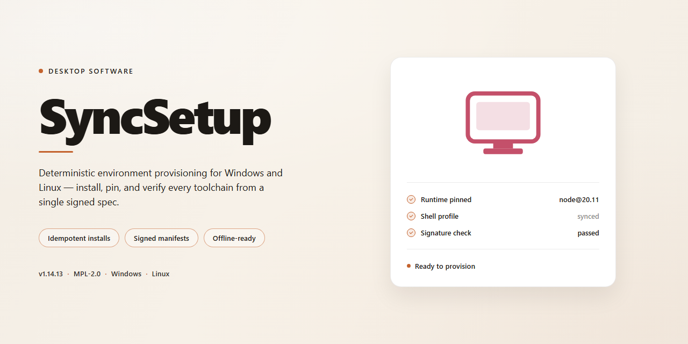

# 🚀 SyncSetup: App Install, Update, Backup & Restore for Windows 11

### 🔧 PowerShell Setup Button

    

---

SyncSetup is a Windows desktop application for installing, updating, backing up, and restoring software across multiple PCs from a single interface. It unifies package sources—including winget, the Microsoft Store, Scoop, Chocolatey, pip, and npm—into one catalogue, resolving each install to its official publisher source and verifying digital signatures before execution. Every operation is validated after completion, with statuses and failure reasons surfaced in plain language rather than assumed. Backup and transfer capabilities capture application settings, browser data, and game configurations with SHA-256 integrity checks, while profiles allow a full app list to be redeployed on new hardware in a single action.

## 📋 System Requirements

- **OS:** Windows 10 / 11
- **Shell:** PowerShell 5.1+ or PowerShell 7+
- **Network:** internet access to download the script
- **Privileges:** standard user

## Features

SyncSetup is built around a catalogue-first workflow: browse, install, verify, and carry your setup to any machine.

- **Unified application catalogue** — A curated set of desktop applications organized by category, with each entry resolvable to the publisher's official distribution source. Install the standard build or the Microsoft Store variant when both exist, pin a specific version, or select an update channel where the publisher provides one.

- **Package manager aggregation** — Beyond the curated catalogue, SyncSetup surfaces packages from the package managers already present on the system, consolidating them into the same install and update pipeline so a single list reflects everything managed on the machine.

- **Source integrity checks** — Every operation resolves to an official source. Where an installer must be fetched directly from the publisher, its digital signature is validated before execution, and installer execution is gated on that verification passing.

- **Post-operation verification** — Install, update, and uninstall operations are not assumed to have succeeded. SyncSetup re-inspects the system state after each operation and reports the verified outcome, distinguishing completed operations from ones that require attention and surfacing the underlying reason for failures.

- **Batched update execution** — All installed applications and aggregated packages appear in a single update view. Updates can be applied in bulk, with safe concurrency control that prevents conflicting installer technologies from running simultaneously. Per-item state is reported as completed, already current, needs attention, or failed.

- **Scheduled maintenance** — Update checks can run on a configurable cadence, with optional reminders at startup or at fixed intervals. Version pinning and permanent per-application ignore rules let you hold specific items back while keeping the rest current.

- **Full installed-applications inventory** — The installed view reflects everything Windows knows about, including portable applications and titles installed by third-party game launchers. A separate tab exposes the full uninstall surface using each program's native uninstaller, and changes made outside SyncSetup are reconciled automatically.

- **File-lock diagnostics** — When an update is blocked by a running process, SyncSetup identifies the holder and offers a close-and-retry path rather than failing silently.

- **Application data backup and restore** — Backup coverage spans browsers, communication clients, editors, and games, capturing bookmarks, preferences, extensions, and local configuration. Restores are integrity-checked with SHA-256 hashing and can target the current machine or a different one.

- **Excluded sensitive data** — Backups deliberately omit credentials, cookies, payment details, and sign-in sessions. No secret material is ever written into a backup artifact.

- **Portable configuration export and import** — The entire SyncSetup configuration can be exported to a single file and imported elsewhere, and named profiles let you reinstall a defined application set on a new machine in one operation.

- **Optional remote backup** — Backup destinations can include an external secret storage target, enabled only by explicit opt-in.

- **System optimization pass** — An on-demand optimization routine terminates idle background processes, memory, and clears temporary files, producing a health score derived from measured system state rather than heuristics.

- **Process classification** — SyncSetup maintains knowledge of common software to distinguish processes safe to close from those that must remain running, including drivers, security software, anti-cheat components, and synchronization agents.

- **Startup management** — Startup entries, including system-wide registrations, are enumerated and can be toggled, with confirmation prompts guarding items identified as important.

- **Hardware and driver overview** — A consolidated view of hardware components and driver status is available alongside the software inventory.

- **Theming and display controls** — Sixteen built-in themes including dark, light, OLED, and high-contrast variants, plus accent color, interface density, and animation controls. Custom themes can be defined.

- **Performance profiles** — Selectable profiles adjust rendering and background behavior for modest or high-end hardware.

- **Localization** — The interface is available in English and French.

- **Navigation and notification surfaces** — Keyboard shortcuts, global search, a notification center, and system tray integration provide access to core workflows without leaving the current context.

- **Self-update with rollback** — SyncSetup updates itself using verified downloads and supports rollback to any previously installed version.

- **Local-first data handling** — Settings and backups reside on the local machine under the application data directory. No account is required, and no advertising or telemetry is present. All remote features remain off unless explicitly enabled.

## How it works

SyncSetup is built around a single desktop application that coordinates every action through a unified engine rather than a collection of separate scripts.

- **Package manager integration:** SyncSetup connects directly to winget and the Microsoft Store as its primary installation sources, and reads from winget, Scoop, Chocolatey, pip, npm and other package registries you have configured. Each request is resolved against the relevant registry, and the official publisher files are retrieved and executed.
- **Verified operations:** Every install, update, uninstall or repair is tracked to completion and then checked against the real state of the system. A result is only reported as successful after SyncSetup has confirmed it on the machine. Failures are surfaced with a plain-language explanation of the cause.
- **Sequential and parallel processing:** Updates are coordinated so that incompatible installers — such as two Windows Installer setups — never run at the same time. Safe batches run in parallel, and progress, download speed and per-item status are reported live.
- **State discovery:** Installed applications, portable apps and game-launcher titles are enumerated from the registry, the file system and known launcher locations, so changes made outside SyncSetup are detected and reflected automatically.
- **Backup and restore pipeline:** For each supported browser, app or game, SyncSetup collects the relevant settings, bookmarks, extensions and configuration data, excludes any credentials, cookies or session tokens, and writes the result to a local backup store. Backups are hashed with SHA-256 so restores can be integrity-checked before applying.
- **Transfer and profiles:** Profiles and full exports are serialized into a portable file, letting a configured app list be reinstalled on another PC in a single pass. Optional online backup is only activated when explicitly enabled.
- **Optimization layer:** A measurement pass inspects running processes, startup entries, temporary files and memory usage, then classifies each item as safe to close, protected, or critical. The resulting health score is derived from those measurements rather than fixed heuristics.
- **Self-update mechanism:** SyncSetup checks for its own, verifies each downloaded update with SHA-512, installs it, and retains the ability to roll back to any previous version.
- **Local-first data model:** All settings, backups and metadata are stored locally in the user's application data directory. No account is required and no telemetry is transmitted.

## Compatibility

SyncSetup is built and tested for Windows desktop systems. It requires Windows 10 version 1809 (build 17763) or later, or Windows 11, on x64 and ARM64 architectures. Both the winget package manager and the Microsoft Store integration rely on components included with these Windows versions, so older builds are not supported.

Administrator rights are optional. SyncSetup operates with standard user permissions and relies on Windows' own elevation prompts when an individual installer requires higher privileges. Apps that explicitly refuse administrator rights are launched with normal user rights automatically.

Installation and updates route through winget; the Microsoft Store is used when that distribution channel is selected for a given app. Systems where winget has been removed or is unavailable can still use the catalogue's Store-based entries, though full catalogue coverage requires winget to be present and functional.

Backups, profiles, and settings are stored locally under the user's application data directory and remain compatible across supported Windows versions. Backup restore is integrity-checked with SHA-256 verification on any supported machine, and export files produced on one PC can be imported on another running the same or a newer SyncSetup release.

Self-updates are verified before installation, and rollback to any previously installed SyncSetup version is available from within the application. No additional runtimes, frameworks, or external dependencies need to be installed separately; SyncSetup ships as a self-contained desktop application.

## FAQ

**Is SyncSetup free to use?**
Yes. SyncSetup is fully free, with no ads, no premium tier, and no account requirement.

**How does SyncSetup differ from standalone package managers?**
SyncSetup operates on top of winget and the Microsoft Store, while also aggregating packages from Scoop, Chocolatey, pip, npm, and other managers into a single interface. Beyond installation, it verifies every operation's result, reports failures with specific reasons, backs up and restores application settings, migrates a full setup to a new machine, and provides optimization and startup management tools.

**Does SyncSetup require administrator privileges?**
No. Normal user rights are sufficient, and Windows will prompt for elevation only when an installer requires it. An optional administrator mode — confirmed once through a standard Windows prompt — reduces repeated elevation requests. Applications that reject administrator rights are automatically launched with standard user rights.

**Where does SyncSetup store configuration and backups?**
All local data resides in `%APPDATA%\syncsetup`. Backups are written to `%APPDATA%\syncsetup\Sauvegardes` by default, or to any folder of your choosing — a cloud-synced folder is a practical choice for accessing backups on another machine.

**What network endpoints does SyncSetup communicate with?**
SyncSetup contacts winget and the package registries in use for installation and updates, GitHub for its own application updates, and icon services for application artwork. Online backup endpoints — a GitHub Gist or a SyncSetup account — are contacted only when explicitly enabled. No telemetry is collected.

**What is included in a backup, and what is excluded?**
Backups cover settings, bookmarks, extensions, profiles, and game data for the supported applications. Passwords, cookies, payment details, and authentication tokens are never included. Restores are integrity-verified using SHA-256 checksums before any data is written.

**Can SyncSetup migrate an existing setup to a new PC?**
Yes. Profiles capture your application list and reinstall it in one click on a new machine, while export and import move the complete SyncSetup configuration as a single file. Application-level backups can be restored on either the current PC or a different one.

**How are SyncSetup's own updates handled?**
SyncSetup updates itself automatically. Each update is downloaded and verified against a SHA-512 checksum before installation, and any previous version can be restored with a one-click rollback.

**Can updates be scheduled or deferred?**
Yes. Scheduled maintenance can check for and apply updates automatically on a configurable schedule. Update reminders can be set at startup or at intervals of 2, 4, or 8 hours, and individual versions or applications can be ignored indefinitely.

**What happens if an installation or update fails?**
Every operation is validated after it completes rather than assumed successful. Failures are reported with a plain-language explanation. If a running process is locking files needed for an update, SyncSetup identifies the process and offers to close it and retry.

**How is SyncSetup uninstalled, and what happens to existing data?**
Uninstall through Windows Settings › Apps › SyncSetup › Uninstall. Configuration and backups remain in `%APPDATA%\syncsetup` until that folder is manually removed.

## Disclaimer

SyncSetup is provided as-is, without warranty of any kind, express or implied, including but not limited to the warranties of merchantability, fitness for a particular purpose, and non-infringement.

By using SyncSetup, you acknowledge and agree to the following:

- **User responsibility.** You are solely responsible for the software installations, updates, backups, restorations, and system optimizations you initiate through SyncSetup. Review each operation before confirming it, particularly bulk actions applied across multiple applications or profiles.
- **Source integrity.** SyncSetup installs and updates applications exclusively through official channels — winget, the Microsoft Store, and publisher-signed installers whose digital signatures are verified prior to execution. SyncSetup does not host, repackage, or redistribute third-party installers itself.
- **Backup scope.** SyncSetup backs up application settings, preferences, and configuration data only. Backups are integrity-checked via SHA-256 at restore time, but no backup system can guarantee recovery of every file in every environment. Maintain independent backups of any data you consider critical.
- **No credentials stored.** SyncSetup never captures, stores, or transmits passwords, cookies, payment details, or active sign-in sessions. Restoring a backup does not restore account access; you will need to sign in to each application again.
- **Third-party software.** Applications installed, updated, or removed through SyncSetup remain governed by their own licenses and terms. SyncSetup is not responsible for the behavior, compatibility, or support status of third-party software.
- **System modifications.** Optimization features — including process termination, startup entry management, and temporary file cleanup — alter system state. SyncSetup applies safeguards and confirmation prompts around protected items, but you remain responsible for the changes you approve.
- **Administrator operations.** Elevated actions always route through the standard Windows UAC prompt. SyncSetup does not attempt to bypass, suppress, or automate around operating system security controls.
- **Compatibility limits.** SyncSetup targets supported Windows desktop environments as documented in the Compatibility section. Behavior on modified, unsupported, or virtualized systems is not guaranteed.
- **No liability.** To the maximum extent permitted by applicable law, the authors and contributors of SyncSetup shall not be liable for any direct, indirect, incidental, special, consequential, or punitive damages, nor for any loss of data, profits, or system availability, arising from the use of or inability to use this software.
- **Acceptance.** Installing, running, or otherwise using SyncSetup constitutes acceptance of this disclaimer. If you do not agree, do not use the software.

## License

SyncSetup is released under the MIT License, which governs the software's source code, documentation, and distributed binaries. Under these terms, you are free to use, copy, modify, merge, publish, distribute, sublicense, and sell copies of the software, provided that the original copyright notice and this permission notice are included in all copies or substantial portions of the software.

The MIT License is a permissive open-source license, meaning it imposes minimal restrictions on how the software may be used and redistributed. It does not require derivative works to be open-sourced, nor does it impose copyleft obligations. Redistribution in binary form, whether modified or unmodified, is permitted without the need to disclose source code, so long as the license notice accompanies the distribution.

**Scope of the license.** The MIT License applies solely to the SyncSetup codebase and its bundled assets created by the SyncSetup project. It does not extend to third-party components, package registries queried at runtime, or publisher-supplied installers that SyncSetup downloads and executes on your behalf. Those components remain governed by their respective upstream licenses, and SyncSetup makes no claim over them.

**No warranty.** The software is provided "as is," without warranty of any kind, express or implied, including but not limited to the warranties of merchantability, fitness for a particular purpose, and non-infringement. In no event shall the authors or copyright holders be liable for any claim, damages, or other liability, whether in an action of contract, tort, or otherwise, arising from, out of, or in connection with the software or its use.

**Attribution.** If you redistribute SyncSetup or a derivative work based on it, you must retain the original copyright notice and permission notice. You may not imply endorsement by the SyncSetup project for any modified distribution. If you publish a fork or repackaged build, clearly distinguish it from the official SyncSetup release so that users can verify provenance.

**Contributions.** By submitting a contribution to the SyncSetup project, you agree that your contribution is licensed under the same MIT terms and that you have the right to grant this license. No separate contributor license agreement is required.

For the avoidance of doubt, this section describes the licensing terms only and does not modify the disclaimer or the safety and data-handling practices described elsewhere in this document.